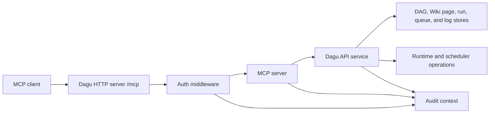

# MCP Architecture

Dagu serves MCP from the same HTTP server as the Web UI and REST API. The MCP route is not a separate daemon, package, or sidecar.

## Request Path

1. The MCP client connects to the public `/mcp` route with Streamable HTTP.
2. Dagu applies the same auth stack used by stream endpoints: query-token support, client IP capture, API key or session validation, and default stream-user injection.
3. MCP requests must satisfy the MCP API-key surface when an API key is used.
4. The MCP server handles tools, resources, prompts, subscriptions, and unsubscribe requests.
5. Tool implementations call the internal frontend API service rather than bypassing Dagu's normal authorization and validation paths.

The route honors the server base path. With `base_path: /dagu`, the route is `/dagu/mcp`.

## Tool Boundary

Dagu exposes a small tool surface by design:

- `dagu_read` reads and searches DAGs and Wiki pages, inspects root and child runs, and reads logs and reference resources.
- `dagu_change` previews or applies DAG definition upserts, renames, and deletions, plus workspace-aware Wiki page changes.
- `dagu_execute` starts, enqueues, retries, or stops DAG runs, approves, rejects, or pushes back steps waiting for a person, and can wait for an identified run to finish.

This keeps client instructions stable and avoids exposing every REST endpoint as a separate MCP tool.

The deprecated `dagu_create_doc` and `dagu_edit_doc` prompts forward to the Wiki prompts.

Step decisions go through the same REST handlers as the Web UI: the approval-gate handlers for a step with `approval`, and the human-task handlers for an [`action: human.task`](/writing-workflows/human-tasks) step. See [Deciding Waiting Steps](/mcp/tools#deciding-waiting-steps).

## Calls From Dagu Cloud

With [remote access](/overview/cloud-remote-access) on, AI apps connected to Dagu Cloud reach the same tools without the `/mcp` route. Each `dagu server` or `dagu start-all` process opens an outbound connection to Dagu Cloud, which carries each call to an MCP handler inside that process.

- The handler serves `dagu_read`, `dagu_change`, and `dagu_execute` and calls the same API service as the `/mcp` route. It is stateless and offers no resource subscriptions.
- Each call runs as the Dagu Cloud user, with the lower of the server's remote access level and the role Dagu Cloud grants that user.
- Audit context records `transport=cloud_relay` and credential type `cloud`.

## Resource Boundary

The MCP server exposes resource templates for current Dagu state:

| Resource | Backing operation |
|----------|-------------------|
| `dagu://reference` | Available built-in MCP references |
| `dagu://dags` | DAG summaries visible to the caller |
| `dagu://dags/{name}/spec` | Current DAG YAML from the DAG spec API |
| `dagu://wiki` | Wiki page tree from the Wiki API across accessible workspaces |
| `dagu://wiki/{workspace}` | Wiki page tree for one workspace |
| `dagu://wiki/{workspace}/{path}` | Markdown content for one Wiki page |
| `dagu://runs` | DAG-run summaries visible to the caller |
| `dagu://runs/{name}/{dagRunId}` | DAG-run details from the run details API |
| `dagu://runs/{name}/{dagRunId}/logs` | DAG-run logs from the logs API |
| `dagu://runs/{name}/{dagRunId}/steps/{stepName}/logs` | Standard output and standard error for one root-run step |
| `dagu://runs/{name}/{dagRunId}/sub/{subRunId}` | Child-run details addressed under the root run |
| `dagu://runs/{name}/{dagRunId}/sub/{subRunId}/steps/{stepName}/logs` | Standard output and standard error for one child-run step |
| `dagu://reference/{topic}` | Built-in MCP guidance bundled with the server |

Clients can subscribe to run resources. Dagu watches subscribed runs and sends a resource update notification when a run reaches a terminal state or stops at a waiting checkpoint. Wiki page resources are read on demand; successful Wiki page mutations continue to notify the Web UI through the existing Wiki API notifier.

The `dagu://docs` resource family remains registered as a deprecated alias for older clients.

## Audit Context

The MCP route seeds an audit context before authentication. That context records:

- `source=mcp`
- `surface=mcp`
- `transport=streamable_http`
- request and correlation IDs
- optional requested workspace from the `workspace` query parameter

After authentication, Dagu adds credential and subject attribution. Tool calls and downstream API actions share the same correlation ID, so an MCP attempt can be linked to the DAG, run, or API-key events it caused.
